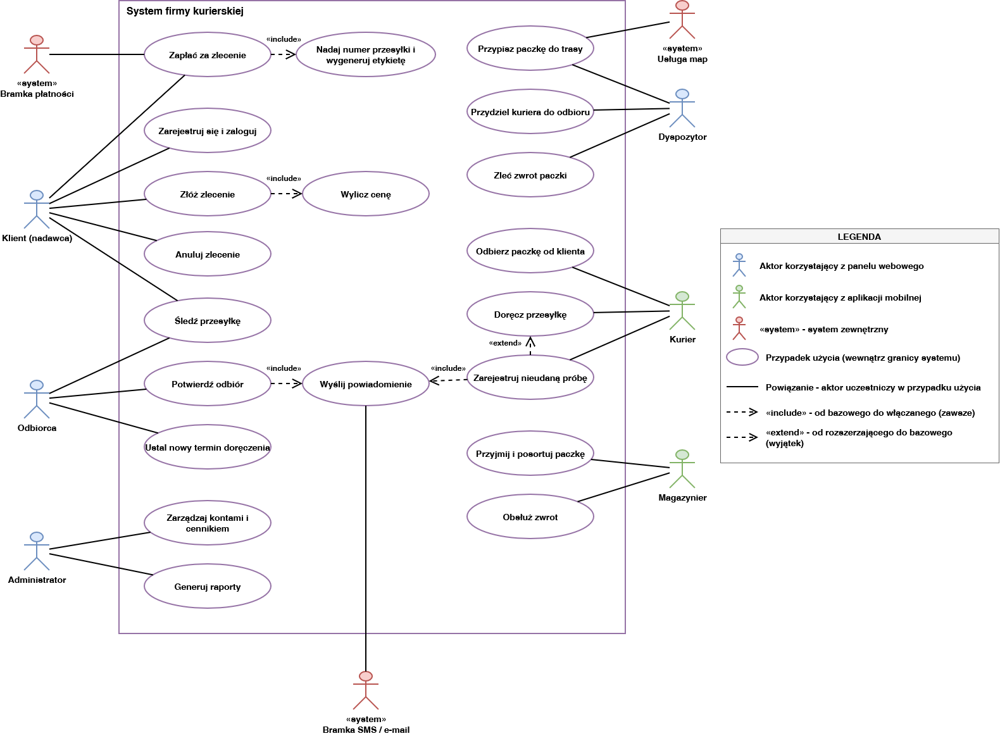

# Diagram przypadków użycia

## 1. Diagram

Źródło diagramu: `przypadki_uzycia.drawio`.

Kolory aktorów są zgodne z diagramem architektury: niebieski oznacza aktora korzystającego z panelu webowego, zielony z aplikacji mobilnej, czerwony system zewnętrzny.

Relacje między przypadkami:
- `«include»`: *Złóż zlecenie* → *Wylicz cenę*, *Zapłać za zlecenie* → *Nadaj numer przesyłki i wygeneruj etykietę*, *Potwierdź odbiór* → *Wyślij powiadomienie*, *Zarejestruj nieudaną próbę* → *Wyślij powiadomienie*.
- `«extend»`: *Zarejestruj nieudaną próbę* → *Doręcz przesyłkę* (występuje tylko wtedy, gdy doręczenie się nie powiedzie).

## 2. Powiązanie przypadków użycia z historyjkami

| Przypadek użycia | Aktorzy | Historyjki |
|------------------|---------|------------|
| Zarejestruj się i zaloguj | Klient (nadawca) | US-01 |
| Złóż zlecenie | Klient (nadawca) | US-02 |
| Wylicz cenę | (włączany w UC-02) | US-02 |
| Zapłać za zlecenie | Klient (nadawca), Bramka płatności | US-03, US-15 |
| Nadaj numer przesyłki i wygeneruj etykietę | (włączany w UC-04) | US-03 |
| Anuluj zlecenie | Klient (nadawca) | US-04 |
| Śledź przesyłkę | Klient (nadawca), Odbiorca | US-05 |
| Przydziel kuriera do odbioru | Dyspozytor | US-06 |
| Przypisz paczkę do trasy | Dyspozytor, Usługa map | US-06, US-09 |
| Odbierz paczkę od klienta | Kurier | US-07 |
| Przyjmij i posortuj paczkę | Magazynier | US-08 |
| Doręcz przesyłkę | Kurier | US-09 |
| Zarejestruj nieudaną próbę | Kurier | US-09 |
| Potwierdź odbiór | Odbiorca | US-10 |
| Zleć zwrot paczki | Dyspozytor | US-11 |
| Obsłuż zwrot | Magazynier | US-11 |
| Ustal nowy termin doręczenia | Odbiorca | US-12 |
| Zarządzaj kontami i cennikiem | Administrator | US-13 |
| Generuj raporty | Administrator | US-14 |
| Wyślij powiadomienie | Bramka SMS / e-mail | US-10, US-15 |

Historyjki US-16 (płatność przy odbiorze) i US-17 (przesyłki międzynarodowe) mają priorytet Won't, więc nie mają przypadków użycia.

## 3. Opis kluczowych przypadków

### UC-04: Zapłać za zlecenie

| Pole | Opis |
|------|------|
| Nazwa | Zapłać za zlecenie |
| Aktor główny | Klient (nadawca) |
| Aktorzy pomocniczy | Bramka płatności (system zewnętrzny) |
| Powiązane historyjki | US-03, US-15 |
| Wyzwalacz | Klient akceptuje cenę zlecenia i przechodzi do płatności |
| Warunki wstępne | Klient jest zalogowany. Zlecenie zostało złożone (adresy, wymiary, waga), a cena wyliczona i zaakceptowana. |
| Warunki końcowe (sukces) | Zlecenie jest opłacone, przesyłka ma numer i etykietę, a zlecenie czeka na przydział kuriera przez Dyspozytora. |
| Warunki końcowe (porażka) | Zlecenie jest anulowane, proces kończy się zdarzeniem „Zlecenie anulowane”. |

**Scenariusz główny:**
1. Klient wybiera metodę płatności (np. BLIK, przelew online) i płaci za zlecenie.
2. System przekazuje płatność do bramki płatności.
3. Bramka płatności zwraca wynik: płatność udana.
4. System nadaje przesyłce numer i generuje etykietę.
5. Zlecenie przechodzi do Dyspozytora, który przydziela kuriera do odbioru paczki.

**Scenariusze alternatywne / wyjątki:**
- **Płatność nieudana.**
  1. Bramka płatności zwraca wynik: płatność nieudana.
  2. System anuluje zlecenie.
  3. Proces kończy się zdarzeniem „Zlecenie anulowane”.
- **Klient przerywa płatność lub wynik płatności nie wpływa do systemu.**
  1. Zlecenie pozostaje nieopłacone i nie jest przekazywane do realizacji.
  2. Dalej obowiązuje scenariusz 3a: bez potwierdzenia wpłaty system anuluje zlecenie.

**Uwagi:**
- Zgodnie z założeniami projektu płatność jest dokonywana z góry, przed odbiorem paczki.
- System nie przechowuje danych kart płatniczych, płatność obsługuje bramka płatności (NFR-04).

### UC-12: Doręcz przesyłkę

| Pole | Opis |
|------|------|
| Nazwa | Doręcz przesyłkę |
| Aktor główny | Kurier |
| Aktorzy pomocniczy | Odbiorca, Dyspozytor, Magazynier, Bramka SMS / e-mail |
| Powiązane historyjki | US-09, US-10, US-11, US-15 |
| Wyzwalacz | Paczka została przypisana do trasy doręczenia kuriera |
| Warunki wstępne | Paczka została odebrana od klienta, przyjęta i posortowana w magazynie, a Dyspozytor przypisał ją do trasy kuriera. Kurier jest zalogowany w aplikacji mobilnej. |
| Warunki końcowe (sukces) | Odbiorca potwierdził odbiór, status przesyłki to „doręczona”, a Klient (nadawca) został powiadomiony. Proces kończy się zdarzeniem „Przesyłka doręczona”. |
| Warunki końcowe (wyjątek: 2 nieudane próby) | Paczka została zwrócona do nadawcy. Proces kończy się zdarzeniem „Paczka zwrócona”. |

**Scenariusz główny:**
1. Kurier jedzie do odbiorcy i próbuje doręczyć paczkę.
2. Kurier stwierdza, że doręczenie jest możliwe (odbiorca jest na miejscu).
3. Odbiorca odbiera paczkę i potwierdza odbiór kodem z powiadomienia lub podpisem.
4. System rejestruje potwierdzenie odbioru i zmienia status przesyłki na „doręczona”.
5. System powiadamia Klienta (nadawcę) o doręczeniu.
6. Proces kończy się zdarzeniem „Przesyłka doręczona”.

**Scenariusze alternatywne / wyjątki:**
- **Doręczenie nieudane (odbiorca nieobecny).**
  1. Kurier rejestruje nieudaną próbę z powodem „odbiorca nieobecny”.
  2. System zwiększa licznik prób i powiadamia Odbiorcę o nieudanej próbie.
  3. Dyspozytor sprawdza, czy to była 2. próba doręczenia.
  4. **Jeśli nie (1. próba):** Dyspozytor ponownie przypisuje paczkę do trasy doręczenia, a scenariusz wraca do kroku 1.
  5. **Jeśli tak (2. próba):** Dyspozytor zleca zwrot paczki do nadawcy.
  6. Magazynier przyjmuje zwrot i odsyła paczkę do nadawcy.
  7. Proces kończy się zdarzeniem „Paczka zwrócona”.

**Uwagi:**
- Zgodnie z założeniami projektu po dwóch nieudanych próbach doręczenia paczka jest zwracana do nadawcy.
- Zgodnie z modelem procesu powiadomienie Klienta (nadawcy) wysyłane jest po doręczeniu, a Odbiorca jest powiadamiany po nieudanej próbie.